

  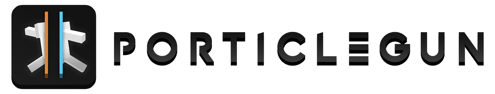

  <b>Two portals. One gun. Every wall is a door.</b> 
  A portal gun, an interdimensional gun and a gravity gun for Minecraft servers, with their own 3D models for Java
  and Bedrock players.

  
  
  
  
  
  

  <a href="#quick-start">Quick start</a> ·
  <a href="#the-interdimensional-gun">Interdimensional gun</a> ·
  <a href="#controls">Controls</a> ·
  <a href="#commands-and-permissions">Commands</a> ·
  <a href="#documentation">Documentation</a> ·
  <a href="CHANGELOG.md">Changelog</a>

  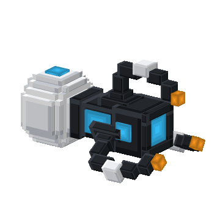
  

<b>PorticleGun</b> · two portals on any wall &nbsp;&nbsp;|&nbsp;&nbsp; <b>Interdimensional gun</b> · green rifts to anywhere

## Highlights

<table>
  <tr>
    <td width="33%" valign="top">
      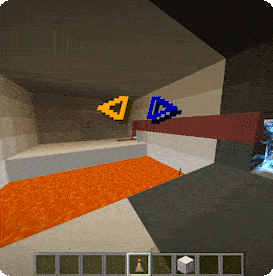 
      <b>Real portal physics</b> 
      Left- or right-click to place a portal where you look. Walk, fall or fly through linked portals on walls, floors
      and ceilings. Speed and view direction carry over, so you can fling yourself across the map. Mobs, items and
      arrows travel too.
    </td>
    <td width="33%" valign="top">
      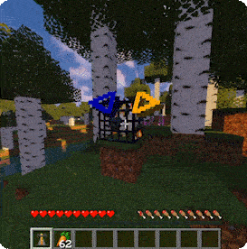
      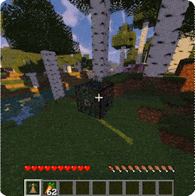 
      <b>Gravity gun included</b> 
      Press the drop key and carry animals, monsters or even blocks around. Chests keep their contents, spawners their mob, even across
      restarts.
    </td>
    <td width="33%" valign="top">
      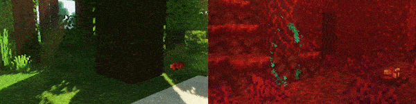 
      <b>Java and Bedrock</b> 
      Bedrock players join through Geyser and Floodgate and get the same gun, the same 3D model and controls that fit
      their device.
    </td>
  </tr>
</table>

## A gun in your colours

  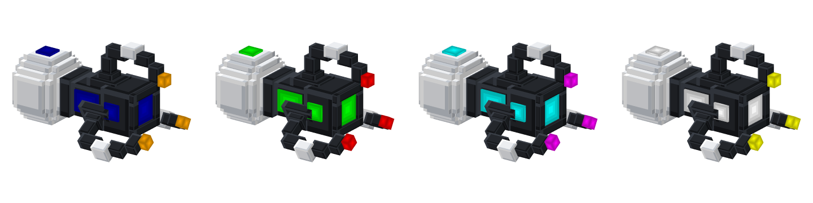

PorticleGun ships its own 3D model, built block by block. Its lights follow the gun's portals: the claw tips glow in
the primary colour, windows and emitter in the secondary colour, and they change the moment you pick new colours.
The resource pack is sent automatically, adds files only in its own namespace and works next to any other pack.
Players without it simply see a brewing stand. More in [docs/resourcepack.md](docs/resourcepack.md).

## The interdimensional gun

The big brother of the PorticleGun. Instead of two portals on walls it tears **green rifts** right into the air: one in
front of you, one at the destination, both wobbling and walkable in both directions, so friends can follow you before
they close. Choose where to go in its menu (sneak + use):

| Destination | |
|---|---|
| **Any world** | A random, safe landing spot: solid ground, room to stand, no lava, water, cactus or nether roof. The worlds of the server show up automatically (up to eight), including ones added later. |
| **World spawn** | The spawn point of any world. |
| **Homes** | Up to seven home points per player, set with one click. |
| **Back** | Where you last stepped into a rift. |
| **Last death** | Back to your belongings. |

Rifts open where you would expect them: on the ground in front of you, closer when a wall is near, floating when you
stand at an edge. At the destination you step out facing open space instead of a wall, and stored places that have
been built over move to the nearest safe spot. A rift pair closes when you walk away from it or after half a minute.

### Portal fluid and rift shards

  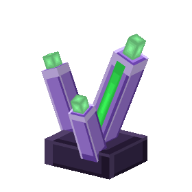
  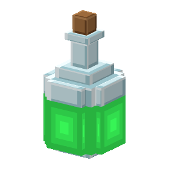
  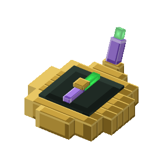

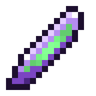 <b>Rift shard</b>
&nbsp;|&nbsp; 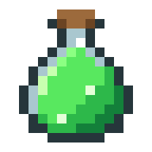 <b>Portal fluid</b>
&nbsp;|&nbsp; 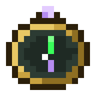 <b>Rift compass</b>
· 3D in hand, animated icons in the inventory

The gun runs on **portal fluid**. Where the End frays, **rift shards** are left behind: mine end stone or hunt endermen
(fortune and looting help), distil three shards with a glass bottle and glowstone dust, and pour the fluid into the
gun's tank from its menu. One bottle opens four rifts, and the glass dome on top of the gun shows how full it is:

  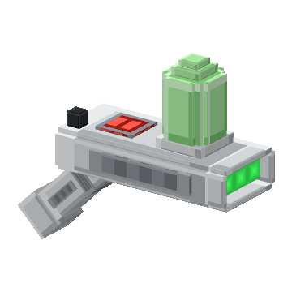

   
  <b>Portal fluid</b> (shapeless): 3 rift shards · glass bottle · glowstone dust

   
  <b>Interdimensional gun</b>: rift shards, nether star, echo shards, a PorticleGun, iron blocks and portal fluid

   
  <b>Rift compass</b>: 3 rift shards · compass · eye of ender

### The rift compass and the rift atlas

Insert a **rift compass** from the gun's menu and the gun is **attuned** for ten minutes: rifts cost no portal fluid,
and the **rift atlas** opens up. Pick a structure and your next rift opens right next to the nearest one: villages,
pillager outposts, desert and jungle temples, witch huts, igloos, woodland mansions, trail ruins, ruined portals,
ancient cities, trial chambers and strongholds in the Overworld, fortresses and bastions in the Nether, end cities in
the End. Underground structures are entered through a safe cave inside or next to them. Another compass adds more
time.

The interdimensional gun is an upgrade: it needs the Overworld (echo shards from the Deep Dark), the Nether (a nether
star) and the End (rift shards). Details in [docs/interdimensional-gun.md](docs/interdimensional-gun.md).

## Features

| | |
|---|---|
| **Portals** | Two linked portals per gun, oval or rectangular, in any of the configured colours |
| **Physics** | Momentum and view direction are rotated into the exit portal, for players and other entities |
| **Interdimensional gun** | Wobbling green rift pairs to homes, any world, spawns, back and your last death, fuelled by portal fluid |
| **Rift atlas** | A rift compass attunes the gun: free rifts and rifts to the nearest village, temple, ancient city, fortress, end city and more |
| **Gravity gun** | Carry blocks and mobs; contents and spawner types survive restarts and crashes |
| **Portal overlay** | Rings around the crosshair in the portal colours show which portals are open |
| **3D models** | Own Java and Bedrock models for both guns and the new items, installed into Geyser automatically |
| **Bedrock** | Floodgate integration, portal status mirrored for controllers, Bedrock pack validated on every change |
| **Protection** | WorldGuard flags for creating portals, using portals and the gravity gun |
| **Languages** | English and German, chosen per player from their game language, fully editable |
| **Server friendly** | Asynchronous saving, worlds loaded late (Multiverse) supported, `/porticlegun reload` for config changes |

## Quick start

1. Download `PorticleGun-<version>.jar` from the [latest release](https://github.com/nurkert/porticle-gun/releases/latest).
2. Put it into your server's `plugins` folder and restart (Spigot or Paper **1.21.4+**, Java 21).
3. Run `/porticlegun` and take your gun, or craft one.

Java players get the 3D model on join. With Geyser and Floodgate on the same server, the Bedrock pack is installed into
Geyser on startup; for Geyser on a proxy see [docs/bedrock.md](docs/bedrock.md). Optional integrations: WorldGuard 7,
Multiverse-Core.

### Crafting

  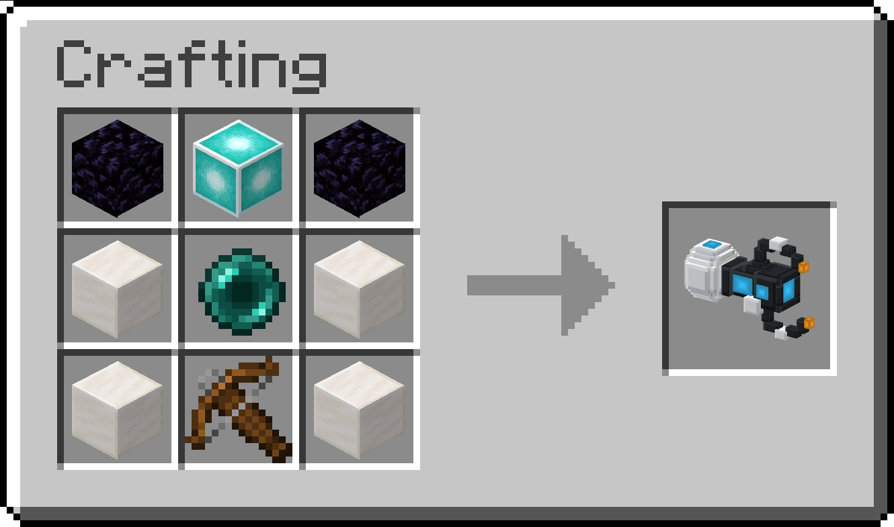

  Obsidian · Beacon · Obsidian 
  Quartz block · Ender pearl · Quartz block 
  Quartz block · Crossbow · Quartz block

Every gun has its own pair of portals. Placing a new primary or secondary portal moves the gun's previous one.

## Controls

| Action | Java (mouse) | Bedrock controller |
|---|---|---|
| Primary portal | Left click | Right trigger (RT / R2) |
| Secondary portal | Right click | Left trigger (LT / L2) |
| Settings: colours, shape, close portals | Sneak + right click | Sneak + left trigger |
| Gravity gun: pick up / let go | Drop key (Q) | Drop |
| Drop the gun itself | Drop key twice quickly | Drop twice quickly |
| Break free when carried by another player | Sneak | Sneak |
| Interdimensional gun: open a rift | Right click | Left trigger (LT / L2) |
| Interdimensional gun: menu | Sneak + right click | Sneak + left trigger |

  

While you hold the gun, two rings around the crosshair show your portals in their colours: filled while a portal is
open, outlined while it is not. The left ring belongs to the left button. Players without the resource pack get a
classic title instead, and for Bedrock players the overlay can be switched on once checked
([docs/bedrock.md](docs/bedrock.md)).

  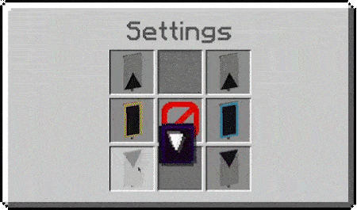

## Commands and permissions

| Command | Description | Permission |
|---|---|---|
| `/porticlegun` or `/pg` | Opens a chest with every PorticleGun item, one click takes it (admins also get the interdimensional gun, shards, fluid and compass) | `porticlegun.command` |
| `/porticlegun removeportal [linked]` | Closes the portal you look at (and its partner) | `porticlegun.command` |
| `/porticlegun give <item> [player] [amount]` | Gives a PorticleGun, interdimensional gun, rift shards, portal fluid or rift compasses | `porticlegun.admin` |
| `/porticlegun list` | Lists all stored guns and their portals | `porticlegun.admin` |
| `/porticlegun remove <id>` | Closes a gun's portals and deletes its data | `porticlegun.admin` |
| `/porticlegun clearplayer <player>` | Does the same for every gun an online player carries | `porticlegun.admin` |
| `/porticlegun reload` | Reloads config, messages and portals | `porticlegun.admin` |

`porticlegun.command` and `porticlegun.interdimensional` (crafting and using the interdimensional gun) are granted to
everyone by default, `porticlegun.admin` to operators. The console can run all admin commands.

## Documentation

| Guide | Covers |
|---|---|
| [Interdimensional gun](docs/interdimensional-gun.md) | Destinations, placement, tank, drops, recipes |
| [Configuration](docs/configuration.md) | Every option in `config.yml`, custom portal colours |
| [Resource pack and 3D model](docs/resourcepack.md) | How the model is delivered, self-hosting, changing the model |
| [Bedrock / Geyser](docs/bedrock.md) | Setup, proxies, what Bedrock players get |
| [WorldGuard](docs/worldguard.md) | Region flags |
| [Localization](docs/localization.md) | Editing texts, adding languages |
| [Development](docs/development.md) | Building, tests, smoke tests, releasing |

  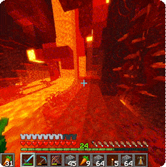 
  Great on any freebuild server to make playing even more fun.

## Contributing

Bug reports and pull requests are welcome, see [CONTRIBUTING.md](CONTRIBUTING.md). Every change is built, tested and
smoke-tested on a real Paper server with and without Geyser.

  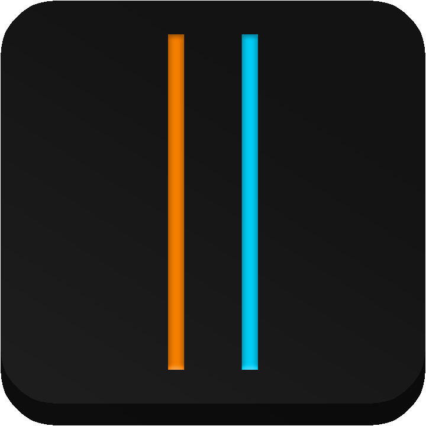 
  PorticleGun is licensed under the <a href="LICENSE">GNU General Public License v3.0</a>.

