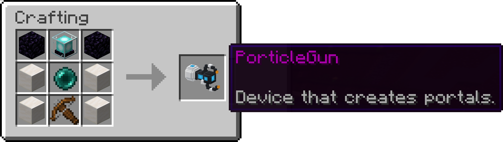

  

  <b>Two portals. One gun. Every wall is a door.</b> 
  A portal gun and a gravity gun for Minecraft servers, with its own 3D model for Java and Bedrock players.

  
  
  
  
  
  

  <a href="#quick-start">Quick start</a> ·
  <a href="#controls">Controls</a> ·
  <a href="#commands-and-permissions">Commands</a> ·
  <a href="#documentation">Documentation</a> ·
  <a href="CHANGELOG.md">Changelog</a>

  

## Highlights

<table>
  <tr>
    <td width="33%" valign="top">
       
      <b>Real portal physics</b> 
      Walk, fall or fly through linked portals on walls, floors and ceilings. Speed and view direction carry over, so
      you can fling yourself across the map. Mobs, items and arrows travel too.
    </td>
    <td width="33%" valign="top">
       
      <b>Gravity gun included</b> 
      Pick up blocks and mobs and carry them around. Chests keep their contents, spawners their mob, even across
      restarts.
    </td>
    <td width="33%" valign="top">
       
      <b>Java and Bedrock</b> 
      Bedrock players join through Geyser and Floodgate and get the same gun, the same 3D model and controls that fit
      their device.
    </td>
  </tr>
</table>

## A gun in your colours

  

PorticleGun ships its own 3D model, built block by block. Its lights follow the gun's portals: the claw tips glow in
the primary colour, windows and emitter in the secondary colour, and they change the moment you pick new colours.
The resource pack is sent automatically, adds files only in its own namespace and works next to any other pack.
Players without it simply see a brewing stand. More in [docs/resourcepack.md](docs/resourcepack.md).

## Features

| | |
|---|---|
| **Portals** | Two linked portals per gun, oval or rectangular, in any of the configured colours |
| **Physics** | Momentum and view direction are rotated into the exit portal, for players and other entities |
| **Gravity gun** | Carry blocks and mobs; contents and spawner types survive restarts and crashes |
| **3D model** | Own Java and Bedrock model, tinted in each gun's colours, installed into Geyser automatically |
| **Bedrock** | Floodgate integration, portal status mirrored for controllers, Bedrock pack validated on every change |
| **Protection** | WorldGuard flags for creating portals, using portals and the gravity gun |
| **Languages** | English and German, chosen per player from their game language, fully editable |
| **Server friendly** | Asynchronous saving, worlds loaded late (Multiverse) supported, `/porticlegun reload` for config changes |

## Quick start

1. Download `PorticleGun-<version>.jar` from the [latest release](https://github.com/nurkert/porticle-gun/releases/latest).
2. Put it into your server's `plugins` folder and restart (Spigot or Paper **1.21.4+**, Java 21).
3. Run `/porticlegun` and take your gun, or craft one.

Java players get the 3D model on join. With Geyser and Floodgate on the same server, the Bedrock pack is installed into
Geyser on startup; for Geyser on a proxy see [docs/bedrock.md](docs/bedrock.md). Optional integrations: WorldGuard 7,
Multiverse-Core.

### Crafting

  

  Obsidian · Beacon · Obsidian 
  Quartz block · Ender pearl · Quartz block 
  Quartz block · Crossbow · Quartz block

Every gun has its own pair of portals. Placing a new primary or secondary portal moves the gun's previous one.

## Controls

| Action | Java (mouse) | Bedrock controller |
|---|---|---|
| Primary portal | Left click | Right trigger (RT / R2) |
| Secondary portal | Right click | Left trigger (LT / L2) |
| Settings: colours, shape, close portals | Sneak + right click | Sneak + left trigger |
| Gravity gun: pick up / let go | Drop key (Q) | Drop |
| Drop the gun itself | Drop key twice quickly | Drop twice quickly |
| Break free when carried by another player | Sneak | Sneak |

The portal status shown while holding the gun marks which portals are open, in their colours. For Bedrock controller
players it is mirrored, so the left marker belongs to the left trigger.

  

## Commands and permissions

| Command | Description | Permission |
|---|---|---|
| `/porticlegun` | Opens the menu with a new gun | `porticlegun.command` |
| `/porticlegun removeportal [linked]` | Closes the portal you look at (and its partner) | `porticlegun.command` |
| `/porticlegun list` | Lists all stored guns and their portals | `porticlegun.admin` |
| `/porticlegun remove <id>` | Closes a gun's portals and deletes its data | `porticlegun.admin` |
| `/porticlegun clearplayer <player>` | Does the same for every gun an online player carries | `porticlegun.admin` |
| `/porticlegun reload` | Reloads config, messages and portals | `porticlegun.admin` |

`porticlegun.command` is granted to everyone by default, `porticlegun.admin` to operators. The console can run all
admin commands.

## Documentation

| Guide | Covers |
|---|---|
| [Configuration](docs/configuration.md) | Every option in `config.yml`, custom portal colours |
| [Resource pack and 3D model](docs/resourcepack.md) | How the model is delivered, self-hosting, changing the model |
| [Bedrock / Geyser](docs/bedrock.md) | Setup, proxies, what Bedrock players get |
| [WorldGuard](docs/worldguard.md) | Region flags |
| [Localization](docs/localization.md) | Editing texts, adding languages |
| [Development](docs/development.md) | Building, tests, smoke tests, releasing |

  

## Contributing

Bug reports and pull requests are welcome, see [CONTRIBUTING.md](CONTRIBUTING.md). Every change is built, tested and
smoke-tested on a real Paper server with and without Geyser.

   
  PorticleGun is licensed under the <a href="LICENSE">GNU General Public License v3.0</a>.

