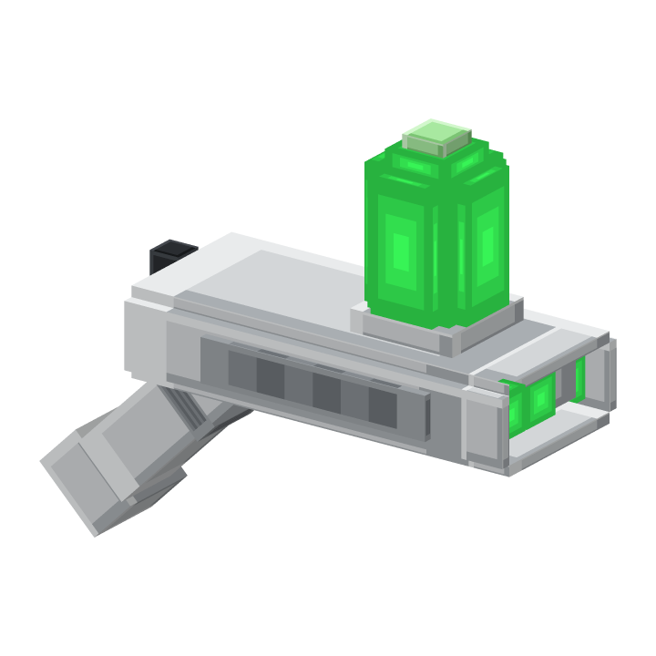

# Interdimensional gun

The interdimensional gun opens green rifts: one directly in front of the player and one at the chosen destination.
Both wobble, can be walked through in both directions and close again on their own.

## Using it

| Action | Java | Bedrock (controller / touch) |
|---|---|---|
| Open a rift to the selected destination | Right click | Use (LT / L2, tap) |
| Open the menu | Sneak + right click | Sneak + use |

While the gun is held, the action bar shows the destination and the tank. Every menu action is a single click, so it
works the same with a mouse, a controller or a touch screen; shift and right clicks do the same as a left click.

## Destinations

- **Random spot in a world**: one candidate per tick is checked around the world spawn (`random-radius`,
  `nether-radius`, `end-radius`), chunks that already exist first, so searching never freezes the server. A spot is
  safe when the ground is solid and harmless (no lava, magma, cactus, fire, powder snow, water), there are two free
  blocks above, no lava next to it, and in the nether it is below the bedrock roof. In the end only islands count; the
  main island is the fallback. If nothing is found within `search-attempts`, the player is told and nothing is used up.
- **World spawn** of any world.
- **Homes**: `homes` slots per player. An empty slot is set to the current position with one click; a set home opens
  a page to travel there, move it to the current position or delete it (with confirmation).
- **Back**: where the player last stepped into a rift.
- **Last death**.

Worlds listed in `disabled-worlds` never show up. Every other world, also ones added later, appears automatically.

## Where rifts appear

- The entrance stands about two blocks in front of the player, on the ground if there is ground, closer when a wall is
  near, and floating in the air when the player stands at an edge.
- At the destination all eight compass directions are scored: room for the exit portal behind the landing spot, free
  space in front of it, and the direction the player walked in. Travellers step out facing open space.
- Stored places (homes, back, death, spawn) that have been built over move to the nearest safe spot within three
  blocks.
- A rift pair closes when its opener is farther than `close-distance` blocks from both portals for two seconds, and
  after `portal-seconds` at the latest. Opening a new pair closes the old one.

Players, mobs and items travel through rifts; WorldGuard's `porticlegun-portal-use` flag applies, and rifts cannot be
opened where `porticlegun-portal-create` is denied.

## Tank, fluid and shards

- **Rift shards** drop when mining end stone (`end-stone-chance`, plus `end-stone-fortune-bonus` per fortune level)
  and from endermen killed by a player (`enderman-chance`, plus `enderman-looting-bonus` per looting level).
- **Portal fluid**: three rift shards, a glass bottle and glowstone dust (shapeless).
- **Tank**: "Fill tank" in the menu takes one portal fluid from the inventory, gives the bottle back and adds
  `rifts-per-fluid` rifts, up to `tank-capacity`. Every rift uses one. The dome on the gun shows the level in five
  steps on Java.
- Rift shards and portal fluid are paper underneath (with their own model); they never work as paper in vanilla
  recipes.

## Crafting the gun

| | | |
|---|---|---|
| Rift shard | Nether star | Rift shard |
| Echo shard | **PorticleGun** | Echo shard |
| Iron block | Portal fluid | Iron block |

The crafted gun starts with `starting-charges` rifts. The PorticleGun used for it is gone, and so are its portals.
Crafting and using the gun needs `porticlegun.interdimensional` (everyone by default).

## Bedrock players

Bedrock players get the 3D gun, the 3D shard and bottle in hand and their icons in the inventory through the Geyser
pack. Rifts appear for them as green particles, because Geyser cannot show the wobbling display entity; it is hidden
from them so nothing looks broken.

## Data

Homes, back and death locations are stored per player in `plugins/PorticleGun/rift.yml`, written asynchronously like
`portals.yml`. Tank and selected destination are stored on the gun item itself.
