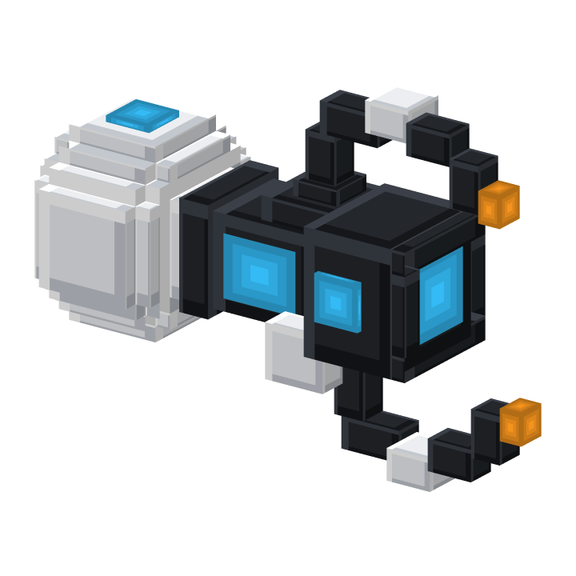

# Resource pack and 3D model



Guns use the item model `porticlegun:portal_gun`. Players with the PorticleGun resource pack see a 3D voxel portal gun
(white rear pod, black barrel, two curved claws) whose lights glow in the gun's portal colours: the claw tips in the
primary colour, the windows and the emitter in the secondary colour. Players without it see a
brewing stand, nothing breaks.

## Java players

The pack only adds files in its own `porticlegun` namespace and replaces no vanilla files, so it works next to the
server resource pack and other packs. It is sent on join with `Player#addResourcePack`, in addition to any other pack.

By default it is downloaded from the GitHub release of the installed version
(`PorticleGun-resourcepack-<version>.zip`); the SHA-1 is embedded in the plugin at build time. To host it yourself,
upload the zip and set:

```yaml
resource-pack:
  url: "https://example.com/PorticleGun-resourcepack-1.3.0.zip"
  sha1: "<sha1 of the zip>"
```

Development builds (`-SNAPSHOT`) have no release, so they only send the pack when a `url` is configured.

The pack also works as a normal client pack: put the zip into `.minecraft/resourcepacks`.

## Portal status overlay

The pack also contains the glyphs of the overlay: two half rings that the plugin sends as a title, which Minecraft
draws around the screen centre, coloured with each portal's colour. They live in the default font on Private Use Area
code points (`U+E9A0`-`U+E9A5`); Java merges font files of all packs, so this only adds characters and changes no other
text. The overlay is only sent to players whose client reported the pack as loaded, everyone else keeps the classic
title. The glyphs are defined in `HUD_GLYPHS` in `scripts/generate_resourcepack.py`; the validator checks that they
match `PortalHud.java`.

## Bedrock players

See [bedrock.md](bedrock.md). The Bedrock pack contains the same model as an attachable and a 2D icon.

## Changing the model

The Java model, the Bedrock geometry, textures, icon and the Geyser mapping are all generated from the element list in
`scripts/generate_resourcepack.py`:

```
python3 scripts/generate_resourcepack.py --preview /tmp/preview
```

writes the files to `src/main/resourcepack/` and renders the model from several angles to `/tmp/preview` to check the
shape without starting the game. `--showcase` re-renders `images/portal_gun_3d.png`. The generator refuses models with
overlapping coplanar faces (they flicker in game). Commit the generated files; the Maven build zips them.

- Java hand/GUI positions: the `display` block in `java_model()`
- Bedrock hand positions: derived from the Java `DISPLAY` values in `bedrock_animations()`
- Default light colours: `DEFAULT_TINTS`
