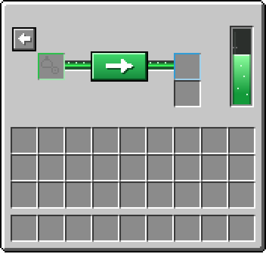

# Resource pack and 3D model


Guns use the item model `porticlegun:portal_gun`. Players with the PorticleGun resource pack see a 3D voxel portal gun
(white rear pod open at the back for the hand, black barrel, three curved claws 120° apart) whose lights glow in the
gun's portal colours: the claw tips in the primary colour, the windows, the emitter and the inside of the pod in the
secondary colour. Players without it see a brewing stand, nothing breaks.

The two lower claws are turned by 30° around the barrel, an angle Java models only allow since 1.21.11. The pack
therefore has an overlay (`free_rotation/`) with the exact model for 1.21.11 and newer; older clients get the same
claws turned by 22.5°.

## Java players

The pack only adds files in its own `porticlegun` namespace and replaces no vanilla files, so it works next to the
server resource pack and other packs. It is sent on join with `Player#addResourcePack`, in addition to any other pack.

By default it is downloaded from the GitHub release of the installed version
(`PorticleGun-resourcepack-<version>.zip`); the SHA-1 is embedded in the plugin at build time. To host it yourself,
upload the zip and set:

```yaml
resource-pack:
  url: "https://example.com/PorticleGun-resourcepack-1.3.0.zip"
  sha1: "<sha1 of the zip>"
```

Development builds (`-SNAPSHOT`) have no release, so they only send the pack when a `url` is configured.

The pack also works as a normal client pack: put the zip into `.minecraft/resourcepacks`.

## Interdimensional gun and rift items

The pack also contains the interdimensional gun (its glass dome shows the tank level in five steps, switched by the
first custom model data float), the rift shard, the portal fluid and the rift compass. The rifts themselves are made of
particles, so they need no pack and look the same on Bedrock. The shard and
the bottle are 3D in hand, on the ground and in item frames and show an animated vanilla-style pixel art icon in
inventories, like vanilla's trident and spyglass. All of it is generated from `scripts/generate_resourcepack.py`.

 


## Portal status overlay

The pack also contains the glyphs of the overlay: two half rings that the plugin sends as a title, which Minecraft
draws around the screen centre, coloured with each portal's colour. They live in the default font on Private Use Area
code points (`U+E9A0`-`U+E9A5`); Java merges font files of all packs, so this only adds characters and changes no other
text. The overlay is only sent to players whose client reported the pack as loaded, everyone else keeps the classic
title. The glyphs are defined in `HUD_GLYPHS` in `scripts/generate_resourcepack.py`; the validator checks that they
match `PortalHud.java`.

## Menus

- **Tank menu**: the rift gun's "Fill tank" chest is drawn for Java players with the pack. Its title starts with
  glyphs that draw over the window's top half in the vanilla style (light grey, vanilla slots and rim, green accents);
  the player inventory below stays vanilla. Only this chest's title contains the glyphs, so no other menu changes.
  Buttons and frame slots are items with the empty model `porticlegun:gui_blank`, the tank gauge is a second glyph
  picked by the fill level. Made in the "tank menu" section of `scripts/generate_resourcepack.py`; the validator checks
  that every glyph the plugin uses exists in the font.
- **Settings menu**: its banners (colours, arrows, close, shape) point at `porticlegun:gui_banner_<colour>`, which
  shows them flat and from the front without pole, exactly 8x16 pixels in the middle of the slot. That needs
  `"attachment": "wall"` in the banner model (26.3+, the `flat_banners` overlay). On those clients the dropper is drawn
  too: plain vanilla grey without the nine slots, a long recessed bar behind each colour column, so arrow, colour and
  arrow read as one slider, and a socket behind each button of the middle column. The glyph only draws in the
  overlay's font; the base font has an empty space of the same width there, so older clients see the vanilla dropper
  with vanilla banners, like Bedrock. The dropper centres its title, so `SettingsGui.java` moves to the window's edge
  and back with shift glyphs and makes the whole title 0 pixels wide; for that it needs the text's width, which it
  knows for the vanilla font's Latin letters (a title with other characters stays vanilla). Made in the "settings
  menu" section of `scripts/generate_resourcepack.py`.

<p align="center">
  
</p>

## Bedrock players

See [bedrock.md](bedrock.md). The Bedrock pack contains the same model as an attachable and a 2D icon.

## Changing the model

The Java model, the Bedrock geometry, textures, icon and the Geyser mapping are all generated from the element list in
`scripts/generate_resourcepack.py`:

```
python3 scripts/generate_resourcepack.py --preview /tmp/preview
```

writes the files to `src/main/resourcepack/` and renders the model from several angles to `/tmp/preview` to check the
shape without starting the game. `--showcase` re-renders `images/portal_gun_3d.png` and the other still images,
`scripts/render_gifs.py` (needs Pillow) the animated ones in `images/animations/`. The generator refuses models with
overlapping coplanar faces (they flicker in game). Commit the generated files; the Maven build zips them.

- Java hand/GUI positions: the `display` block in `java_model()`
- Bedrock hand positions: derived from the Java `DISPLAY` values in `bedrock_animations()`
- Default light colours: `DEFAULT_TINTS`
